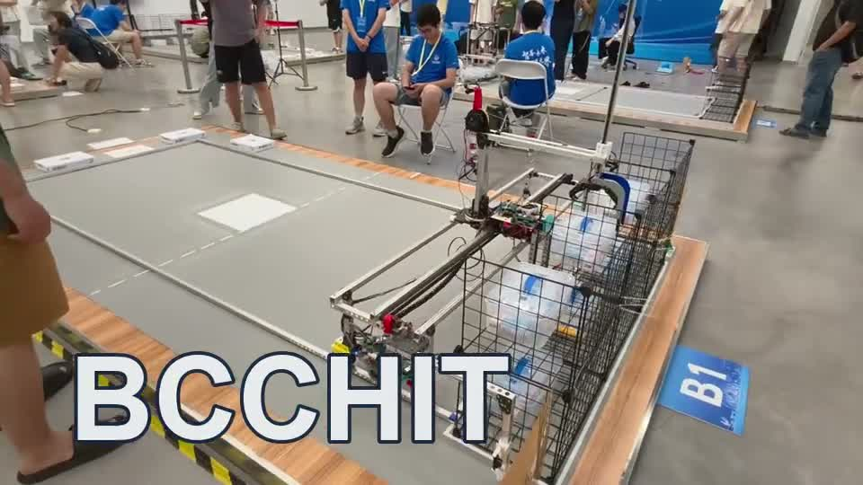
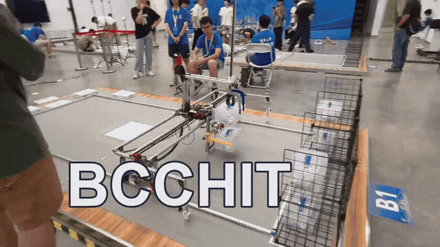
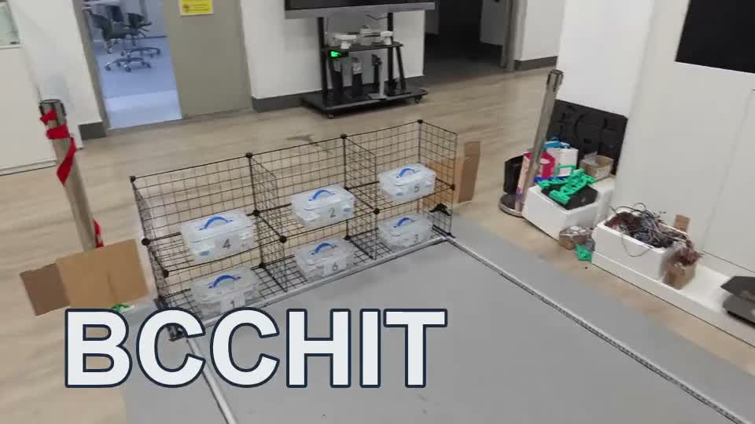
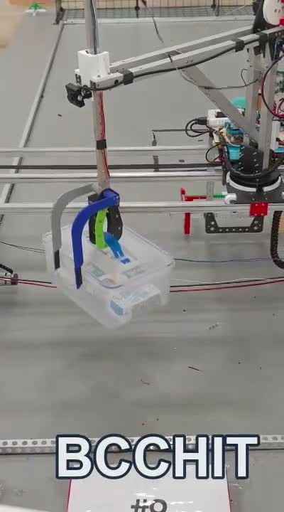

# 凌霄 · 视觉感知与机械臂控制

**LingXiao Crane Robot 2025** · Raspberry Pi / STM32 / YOLO / UART / CAN / CyberGear

面向物流仓储搬运任务的竞赛机器人。本仓库展示 BCCHIT 负责的树莓派视觉系统、STM32 视觉数据接收模块和 CyberGear 机械臂高级控制代码。



**[▶ 比赛任务视频（有声）](docs/assets/task.mp4)** · [视觉与现场联调](docs/assets/vision.mp4) · [机械臂运动](docs/assets/arm-1.mp4) · [夹取演示](docs/assets/arm-2.mp4)

## 项目成果

2025 年中国大学生机械工程创新创意大赛物流技术创意赛全国总决赛一等奖。项目完成视觉识别、抓取、搬运与码垛的整车集成；视频展示团队整机成果，代码目录对应本人工作。

## 我的工作

| 模块 | BCCHIT 负责的内容 | 代码入口 |
| --- | --- | --- |
| 双摄像头视觉 | 图像采集、YOLO 推理集成、位置映射、结果校验、Linux 部署 | [视觉系统](vision_system_raspberrypi/) |
| 树莓派与主控通信 | 串口解析、主动请求、规则补全、缓存与超时处理 | [接收模块](receive_from_pi_module/) |
| 机械臂高级控制 | 分段动态 PD、运控/位置混合控制、梯形速度规划、CAN 联调 | [机械臂分控](jixiebi/) |
| 现场系统联调 | 摄像头设备映射、开机自启、识别与执行链路调试 | `vision_system_raspberrypi/systemconfigs/` |

## 系统如何协同

```text
货架摄像头 + 置物区摄像头
            ↓
Raspberry Pi：YOLO → 位置映射 → 结果校验与缓存
            ↕ UART：START / PERFECT / REQUEST 等信号
STM32 主控：接收解析 → 任务调度（团队模块）
            ↓
机械臂分控：动态 PD / 混合控制 / 梯形速度规划
            ↓ CAN
CyberGear 电机与执行机构
```

## 三个工程问题

### 识别结果如何进入控制链路

双摄像头分别观察货架和置物区，检测结果转换成离散位置编号，再按比赛布局规则校验。系统支持投票共识与连续匹配两种思路，并缓存最近结果与满足规则的结果，便于主控主动读取。

货架与置物区分别配置 960、1280 的推理尺寸；连续匹配次数通过 `config.json` 中的 `required_matches` 调整，当前为 1。

### 主控如何处理缺失数据

`PERFECT` 优先请求满足布局规则的缓存，`REQUEST` 获取最近结果；接收端支持规则补全和超时处理。竞赛版含超时随机补齐布局的保底分支，复用时需根据实际任务选择处理方式。

### 电机如何兼顾快速运动和位置保持

`MiAngleControl_MultiStage_V3` 按误差区间插值调整 PD 参数，区分空载和带载；`Move_and_Hold_Hybrid` 先以运控模式趋近目标，再切换位置模式保持。同步位置等待与梯形速度规划用于其他运动场景。记录的满载 90° 旋转响应小于 2.6 s、定位误差小于 0.5°。

## 实机演示



| 视觉与现场联调 | 机械臂夹取 |
| --- | --- |
| [](docs/assets/vision.mp4) | [](docs/assets/arm-2.mp4) |

## 阅读与运行

1. **视觉系统**：准备 Raspberry Pi/Linux、Python、OpenCV、模型加载库和 pyserial，连接两台相机并配置 `/dev/camera_shelf`、`/dev/camera_area`。
2. **参数配置**：修改 `vision_system_raspberrypi/config.json` 中的模型路径和串口参数。当前模型目录为 `/home/pi/code/models/`，串口为 `/dev/ttyAMA0`，9600 波特、2 停止位。
3. **STM32 接入**：将接收模块集成到主控，使用原 Keil/CubeMX 工程配置机械臂分控，核对引脚、电机 ID、CAN 参数与机构行程。
4. **联调顺序**：先验证相机与识别，再连接串口和执行机构；开机服务及设备映射配置位于 `systemconfigs/`。

```text
vision_system_raspberrypi/   Python 视觉系统、模型与配置
receive_from_pi_module/      STM32 串口数据接收与解析
jixiebi/                    STM32 机械臂分控工程
docs/assets/                BCCHIT 水印照片、GIF 与视频
```

基础 CyberGear 驱动及 STM32 HAL/CMSIS 来自第三方，相关文件保留原署名与许可证；整机成果由团队共同完成。
